# Vochito — Proyecto de Aplicaciones Web 2026

## Descripción del proyecto

Vochito es un proyecto académico desarrollado para la asignatura de Aplicaciones Web. Su finalidad es construir un sitio web organizado mediante diferentes páginas, utilizando tecnologías web y herramientas de control de versiones.

El proyecto contempla páginas informativas, catálogo, gestión de pedidos, funcionalidades relacionadas con la atención al usuario y documentación de requerimientos no funcionales.

## Objetivo general

Desarrollar un sitio web que cumpla con los requerimientos establecidos para el proyecto Vochito, aplicando HTML5, CSS, JavaScript y Bootstrap, así como buenas prácticas de organización, diseño, accesibilidad y colaboración mediante Git y GitHub.

## Integrantes del equipo

- **Líder del proyecto:** Vital Millan Dayra Naomi
- **Backend:** Guerrero López Miguel Angel
- **Frontend 1:** Carpio Campos Rodrigo
- **Frontend 2:** Ortiz Salguero Geazul Guadalupe
- **Analista:** Lorenzana Hernández Aarón Dahir

## Tecnologías y herramientas

- HTML5
- CSS3
- JavaScript
- Bootstrap 5
- Visual Studio Code
- Git
- GitHub
- Live Server

## Estructura del proyecto

```text
Vochito-apps-2026/
│
├── Docs/
│   └── Documentacion del proyecto
│
├── css/
│   └── Hojas de estilo CSS
│
├── img/
│   └── Imagenes del proyecto
│
├── js/
│   └── Archivos JavaScript
│
├── index.html
├── nosotros.html
├── productos.html
├── servicios.html
├── contacto.html
│
├── iniciosesion.html
├── catalogo.html
├── busquedas.html
├── pedidos.html
├── historial.html
├── modificacion.html
├── cancelacion.html
├── notificaciones.html
├── incidencias.html
├── ayuda.html
├── privacidad.html
├── evidencias.html
│
├── RNF03.html
├── RNF04.html
├── RNF05.html
├── RNF06.html
├── rnf.html
├── reporte_desempeno.html
├── tiempo_respuesta.html
│
└── README.md
```

### Descripción de las carpetas

- **Docs/**: documentación y materiales relacionados con el proyecto.
- **css/**: hojas de estilo que definen la presentación visual de las páginas (`tema.css` ajusta el tema oscuro y `utilidades.css` reemplaza los estilos en línea).
- **img/**: imágenes y recursos visuales utilizados en el sitio.
- **js/**: scripts de JavaScript para agregar interactividad (un archivo por funcionalidad; `tema.js` se carga en todas las páginas).
- **README.md**: documento que describe el proyecto, su estructura y las instrucciones para visualizarlo.

### Páginas principales

| Archivo             | Descripción                                 |
| ------------------- | ------------------------------------------- |
| `index.html`        | Página principal del sitio.                 |
| `nosotros.html`     | Información general del proyecto o empresa. |
| `productos.html`    | Presentación de productos.                  |
| `servicios.html`    | Información sobre los servicios.            |
| `contacto.html`     | Información y medios de contacto.           |
| `iniciosesion.html` | Interfaz de inicio de sesión.               |
| `catalogo.html`     | Catálogo de productos.                      |

### Páginas relacionadas con funcionalidades

| Archivo                  | Propósito                                           |
| ------------------------ | --------------------------------------------------- |
| `busquedas.html`         | Interfaz de búsqueda.                               |
| `pedidos.html`           | Consulta o gestión de pedidos.                      |
| `historial.html`         | Consulta del historial.                             |
| `modificacion.html`      | Interfaz de modificación de información.            |
| `cancelacion.html`       | Interfaz relacionada con cancelaciones.             |
| `notificaciones.html`    | Presentación de notificaciones.                     |
| `incidencias.html`       | Registro o consulta de incidencias.                 |
| `ayuda.html`             | Información de ayuda.                               |
| `privacidad.html`        | Información relacionada con la privacidad.          |
| `evidencias.html`        | Presentación de evidencias del proyecto.            |
| `RNF03.html`             | Alta disponibilidad.                                |
| `RNF04.html`             | Requerimiento no funcional 04.                      |
| `RNF05.html`             | Requerimiento no funcional 05.                      |
| `RNF06.html`             | Requerimiento no funcional 06.                      |
| `rnf.html`               | Página general de requerimientos no funcionales.    |
| `reporte_desempeno.html` | Información relacionada con el desempeño.           |
| `tiempo_respuesta.html`  | Información relacionada con el tiempo de respuesta. |

Las descripciones específicas de RNF04, RNF05 y RNF06 deben coincidir con los requisitos definidos por el equipo.

## Componentes de Bootstrap

El proyecto utiliza los siguientes componentes y utilidades de Bootstrap 5.3, varios de ellos controlados desde JavaScript:

- **Navbar:** menú de navegación.
- **Container:** organización del contenido.
- **Grid System:** distribución en filas y columnas.
- **Cards:** presentación de productos y servicios.
- **Buttons:** botones de navegación y acciones.
- **Forms:** formularios para captura de información.
- **Responsive utilities:** adaptación a diferentes tamaños de pantalla.
- **Modal:** actualización de estatus e incidencias (`new bootstrap.Modal`).
- **Alert:** avisos tras una acción (éxito, error, advertencia).
- **Validación de formularios:** `is-valid`, `is-invalid` e `invalid-feedback`.
- **Progress:** barra de avance del formulario de pedidos.
- **Form switch + `data-bs-theme`:** cambio entre tema claro y oscuro.
- **Tablas y listas:** pedidos y cola de solicitudes con botones de acción.

## Interacciones implementadas

Se implementaron **8 interacciones** (6 de la lista obligatoria y 2 de la libre). Todos los manejadores son **funciones con nombre** registradas con `addEventListener` (no hay atributos `onclick` en el HTML) y se usa **delegación de eventos** en `productos.js`, `pedidos.js` y `rnf04-comunicaciones.js`.

| #   | Interacción                             | Integrante responsable | Selectores usados                   | Eventos usados                                                          | Componente Bootstrap                                     | Archivos                                                         |
| --- | --------------------------------------- | ---------------------- | ----------------------------------- | ----------------------------------------------------------------------- | -------------------------------------------------------- | ---------------------------------------------------------------- |
| 1   | Validación de formulario en tiempo real | Miguel                 | `getElementById`, `checkValidity()` | `input`, `blur` / `focusout`, `submit`, `preventDefault()`              | `is-valid`, `is-invalid`, `invalid-feedback`             | `iniciosesion.js`, `pedidos.js`                                  |
| 2   | Modal con información dinámica          | Miguel                 | `getElementById`, `closest()`       | `click` (delegado), `submit`, `dataset` (`data-id`)                     | Modal                                                    | `productos.js`, `pedidos.js`                                     |
| 3   | Notificación tras una acción            | Miguel                 | `getElementById`                    | `submit`, `click`                                                       | Alert (`alert-success`, `alert-danger`, `alert-warning`) | `pedidos.js`, `productos.js`, `solicitudes.js`, `formularios.js` |
| 4   | Filtrado y búsqueda de elementos        | Miguel                 | `getElementById`, `querySelector`   | `input`, `submit`, `reset`, `classList.toggle('d-none')`                | Cards, form-control                                      | `busquedas.js`, `productos.js`                                   |
| 5   | Agregar y eliminar elementos            | Aarón (confirmar)      | `getElementById`, `closest()`       | `click` (delegado), `input`, `createElement`, `appendChild`, `remove()` | Lista con botones `btn-outline-danger`                   | `rnf04-comunicaciones.js`                                        |
| 6   | Cambio de tema claro/oscuro             | Rodrigo (confirmar)    | `querySelector`, `getElementById`   | `change`, `classList`, `data-bs-theme`                                  | Navbar, form-switch                                      | `tema.js`, `tema.css`                                            |
| L1  | Mostrar/ocultar contraseña              | Miguel                 | `getElementById`, `querySelector`   | `click`                                                                 | Input group, botón                                       | `iniciosesion.js`                                                |
| L2  | Barra de progreso del formulario        | Geazul (confirmar)     | `getElementById`, `querySelector`   | `input` (delegado), `focusout` (delegado), `reset`                      | Progress (`w-25`, `w-50`, `w-75`, `w-100`)               | `pedidos.js`, `pedidos.html`                                     |

### Justificación de los selectores

- **`getElementById`**: para un solo elemento con `id` único (formularios, tablas, botones). Es el método más directo y claro.
- **`querySelector`**: para el primer elemento que coincida con una clase o atributo dentro de otro nodo (por ejemplo, el `<i>` dentro de un botón o los nodos de una tarjeta recién creada).
- **`querySelectorAll`**: cuando hay varios elementos y se necesitan todos (por ejemplo, todos los formularios con la clase `needs-validation`).
- **`closest()`**: dentro de la delegación de eventos, para subir desde el elemento pulsado hasta el botón que tiene `data-id`.

## Evidencia del tablero Kanban

_Pegar aquí el enlace o la captura del tablero de GitHub Projects con una tarjeta por interacción._

## Flujo de trabajo con Git y GitHub

El equipo utiliza un flujo de trabajo basado en Issues, ramas, commits y Pull Requests para organizar los cambios.

```text
Issue
  ↓
Feature Branch
  ↓
Commits
  ↓
Pull Request
  ↓
Revisión del código
  ↓
Merge a main
```

1. **Issue:** registrar una tarea o problema.
2. **Feature Branch:** crear una rama independiente para desarrollar la tarea.
3. **Commits:** guardar avances con mensajes descriptivos.
4. **Pull Request:** solicitar la revisión de los cambios.
5. **Revisión:** comprobar que el código cumpla con los requisitos.
6. **Merge:** integrar los cambios aprobados en `main`.

## Cómo ejecutar el proyecto

1. Clonar o descargar el repositorio.
2. Abrir la carpeta del proyecto en Visual Studio Code.
3. Verificar que las carpetas `css/`, `img/` y `js/` estén disponibles.
4. Abrir el archivo `index.html`.
5. Ejecutarlo con la extensión Live Server.
6. Comprobar que las páginas, imágenes, estilos y enlaces funcionen correctamente.

## Buenas prácticas

- Mantener una estructura de archivos organizada.
- Utilizar etiquetas semánticas de HTML5.
- Agregar atributos `alt` a las imágenes.
- Asociar etiquetas `label` con los campos de los formularios.
- Verificar que las rutas de los recursos sean correctas.
- Utilizar commits descriptivos.
- Trabajar en ramas independientes.
- Revisar los cambios mediante Pull Requests.
- Probar el diseño en diferentes tamaños de pantalla.

## Estado del proyecto

**Estado:** En desarrollo.

El equipo continúa trabajando en las páginas, los estilos, las funcionalidades y los requerimientos establecidos.

## Reflexión del equipo

La interacción más difícil fue lograr que JavaScript funcionara correctamente con los componentes de Bootstrap, sobre todo el modal y la validación en tiempo real, porque había que entender cómo se relacionan los eventos con las acciones del usuario.
También costó coordinar las ramas y los pull requests para que todos aportáramos.
La delegación de eventos nos ofrece la ventaja de usar un solo controlador para varios elementos, incluso para los que se crean después de cargar la página, como los botones de la tabla de pedidos o de la cola de solicitudes.
Gracias a eso el código es más corto, más ordenado y más fácil de mantener.
Al combinar JavaScript con Bootstrap aprendimos que Bootstrap aporta la estructura y los estilos de los componentes, mientras que JavaScript les da comportamiento.
Con `classList` cambiamos clases como `is-invalid`, `d-none` o `w-50`, y con `data-bs-theme` cambiamos todo el tema del sitio.
También aprendimos a identificar errores en la consola y a buscar soluciones apoyándonos entre compañeros.
La distribución de actividades nos permitió aprovechar las habilidades de cada integrante.
En general, esta práctica mejoró nuestros conocimientos de JavaScript, nuestra comunicación y nuestra forma de trabajar en equipo.

### Reflexiones individuales

**GEAZUL**
Considero que nuestro equipo ha trabajado de manera positiva, ya que todos hemos colaborado para cumplir con las actividades. Una de las interacciones más difíciles fue hacer que JavaScript funcionara correctamente con los componentes de Bootstrap, porque necesitábamos comprender cómo conectar los eventos con las acciones de cada elemento. La delegación de eventos nos ayuda a organizar mejor el código y permite manejar las acciones de varios elementos desde un mismo controlador. También aprendimos que Bootstrap facilita la creación del diseño de una página web, mientras que JavaScript permite agregar funciones interactivas. Aunque en ocasiones tenemos diferentes ideas, tratamos de escucharnos y llegar a acuerdos para continuar trabajando. Además, aprendimos a identificar errores y buscar soluciones con el apoyo de nuestros compañeros. La distribución de actividades nos permitió aprovechar las habilidades de cada integrante. En general, esta práctica nos ayudó a mejorar nuestros conocimientos, nuestra comunicación y nuestra forma de trabajar en equipo.

**Rodrigo**

La experiencia de formar parte del grupo que me asignaron me permite aprender, convivir y trabajar en equipo. Considero que el respeto, la responsabilidad y la comunicación son importantes para lograr nuestros objetivos. Mi propósito es aportar lo mejor de mí, aprender de los demás y contribuir a un ambiente de compañerismo y colaboración.

**Miguel**

A pesar de no tener conocimientos previos de como utilizar javascript y trabajar en un equipo de desarrollo ya dedicado en desarrollar software, mi experiencia a sido muy buena, ya que mis compañeros de equipo estan disponibles y son accesibles a las dudas que llego a tener en el momento, junto a que tambien nos llegamos a organizar muy bien dentro de videollamadas para comentar todo lo que se necesite realizar, y lo mejor de todo siendo que todos cooperan y trabajan según a lo que el lider asigna sin quitar los aportes que hace ella

**Aaron**

**Reflexión personal del equipo**

Formar parte de mi equipo ha sido una experiencia muy bonita, porque he aprendido cosas nuevas y también he podido convivir y trabajar con mis compañeros. Al principio no tenía conocimientos de JavaScript ni había trabajado en un equipo dedicado al desarrollo de software, pero poco a poco me he ido adaptando gracias al apoyo de todos. Considero que el respeto, la comunicación y la responsabilidad son muy importantes para que podamos trabajar bien juntos. Algo que me gusta de mi equipo es que, cuando tengo dudas o se nos presenta algún problema, mis compañeros están dispuestos a ayudarme y buscamos la manera de encontrar una solución. También me parece muy buena la organización de las videollamadas, porque nos permiten ponernos de acuerdo y repartir las actividades. Nuestra líder nos ayuda a organizarnos y cada integrante aporta algo importante al proyecto. Me siento contenta de formar parte de este equipo, porque además de aprender sobre programación, estoy aprendiendo a trabajar con otras personas. Espero seguir mejorando, aportar nuevas ideas y continuar trabajando con mis compañeros de la misma manera.

**Naomi**

Durante esta práctica, como equipo aprendimos la importancia de trabajar juntos y compartir nuestros conocimientos. La interacción más difícil fue lograr que JavaScript funcionara correctamente con los componentes de Bootstrap, ya que tuvimos que comprender cómo se relacionaban los eventos con las acciones del usuario. La delegación de eventos nos ofrece la ventaja de utilizar un solo controlador para varios elementos, lo que permite tener un código más organizado y sencillo. También aprendimos que Bootstrap facilita el diseño de páginas web mediante componentes prediseñados. Al combinar JavaScript con Bootstrap, comprendimos cómo agregar interactividad a elementos como botones, menús y formularios. Además, mejoramos nuestra capacidad para resolver errores y encontrar soluciones. La comunicación y la colaboración fueron fundamentales para completar las actividades. Finalmente, esta experiencia nos ayudó a fortalecer nuestros conocimientos y a trabajar mejor como equipo.

## Evidencias

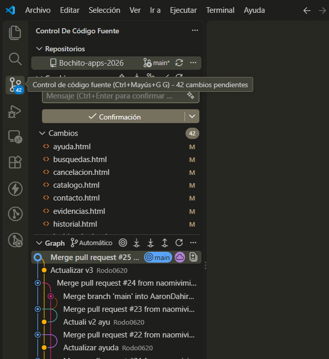
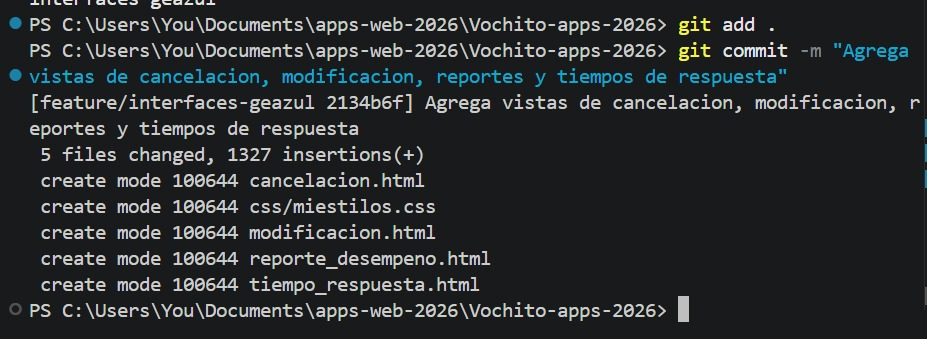
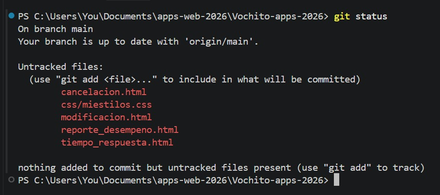
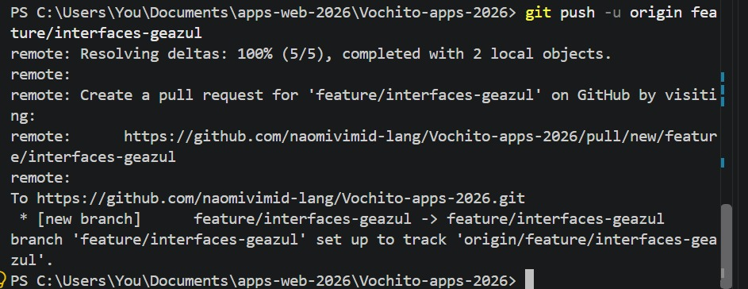
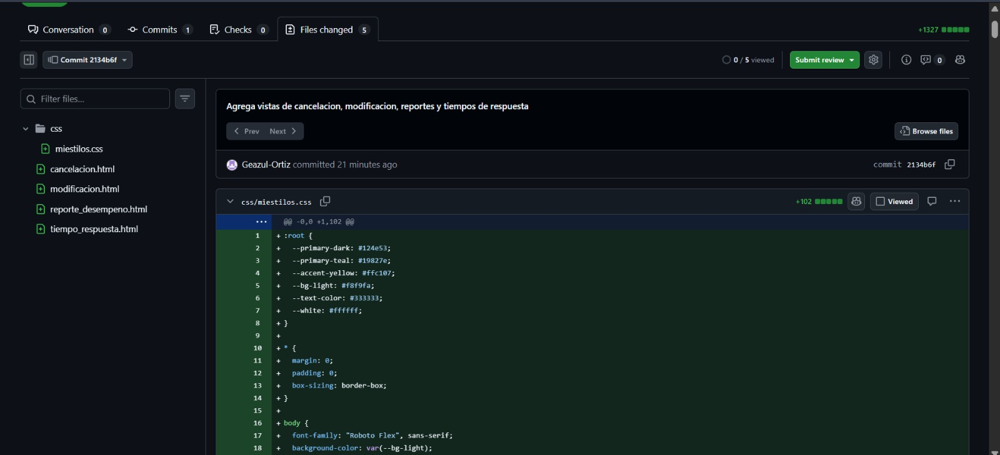
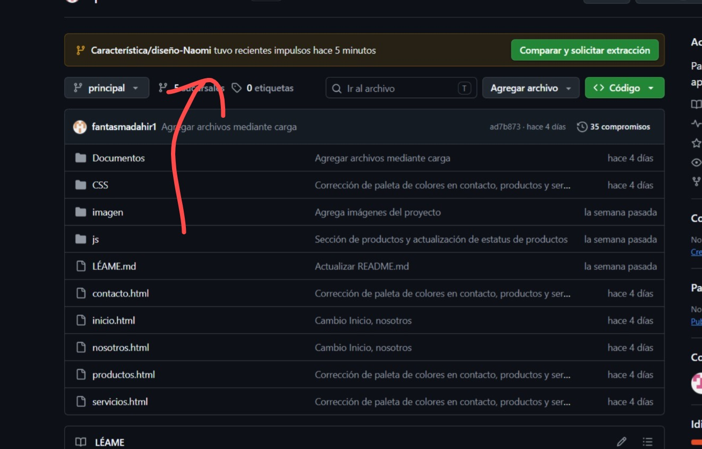
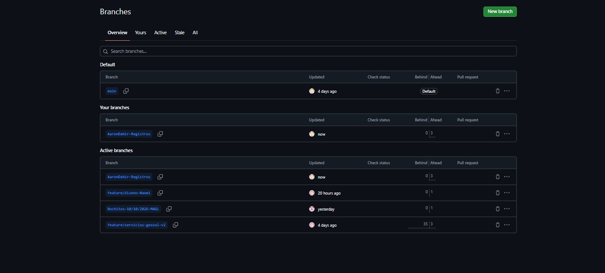
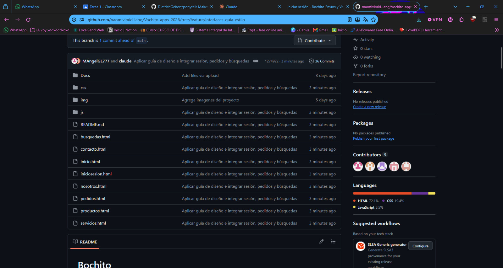
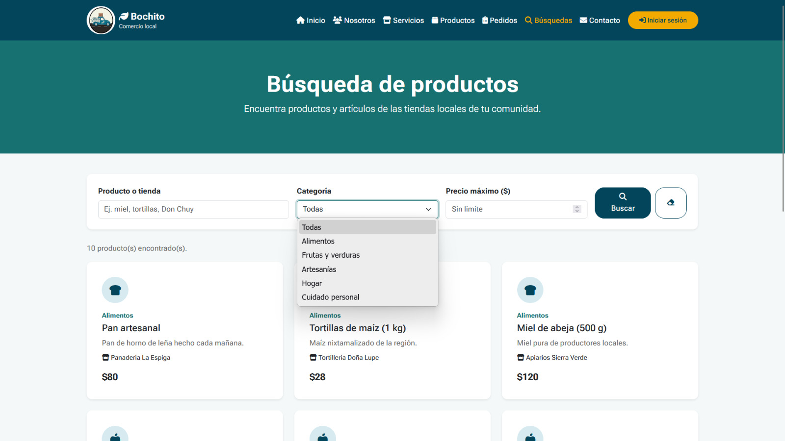
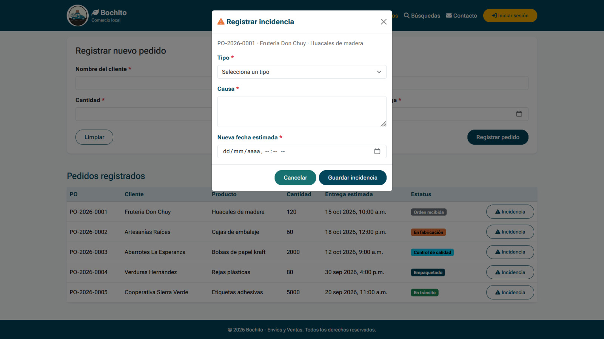
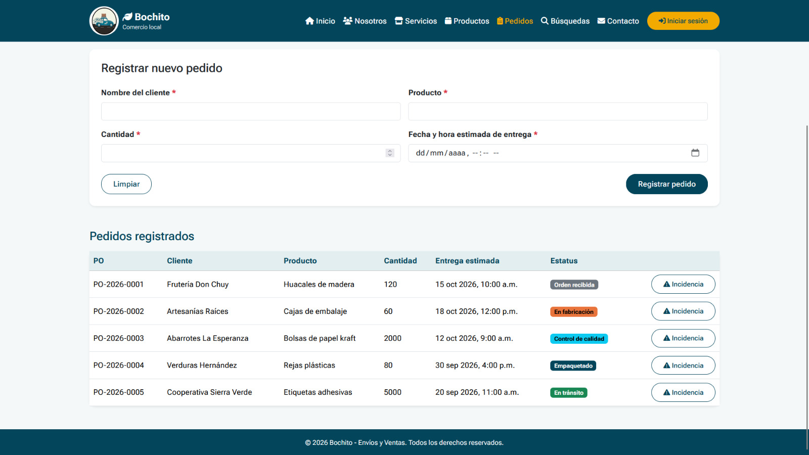
